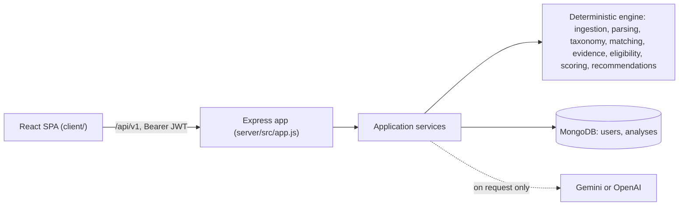

# ATS Resume Checker

**Check how well a resume reads, and how strongly it matches a job, with every point explained.**

ATS Resume Checker is a MERN web application (MongoDB, Express, React, Node.js). You upload a resume (PDF, DOCX or TXT) or paste it, and optionally paste a job description. A **deterministic, rule-based engine** then produces:

- **Resume Health** (always): how readable, structured, complete and well-evidenced the resume is on its own.
- **Job Match** (only with a job description): requirement-by-requirement assessment against the job, each backed by a **verbatim line from the resume**, plus a separate **eligibility** verdict for hard requirements.
- **Prioritised recommendations**, each tied to a specific finding, with "only if it's true" integrity notes.
- **Optional AI interview preparation** (Gemini or OpenAI) that explains a stored result. AI can **never** change a score, status or recommendation.

> **Project status (2026-10-23):** a well-tested prototype. 22 backend test suites (442 tests) pass locally on Node.js 22.20.0, and the frontend lints and builds. It is **not deployed**, the Docker image has never been built, and, as of this review (2026-10-23), CI has not yet run on this code. Known limitations are listed [below](#current-limitations) and in [docs/KNOWN_LIMITATIONS_AND_ROADMAP.md](docs/KNOWN_LIMITATIONS_AND_ROADMAP.md).

---

## Why this project exists

Applicant tracking systems parse resumes into text before a recruiter searches or filters them. Simple "ATS checkers" often just count keywords, which goes wrong in predictable ways: "Java" found inside "JavaScript", a skill in a list treated the same as one used in a real role, every JD word weighted equally, and unexplained scores. This project instead:

- **matches skills through a curated taxonomy** with boundary-safe recognition and explicit "never equivalent" pairs (Java ≠ JavaScript, C ≠ C++ ≠ C#, React ≠ React Native)
- **grounds every result in evidence**: no requirement is "met" without the resume line that shows it
- **separates eligibility from fit**: a missing clearance is reported as a gate and never silently lowers the match score
- **treats absence as uncertainty, not failure**: silence on work authorisation is "unknown", not "failed"
- **explains every score**: score + deductions = 100, and each deduction names a requirement or check

It does **not** reproduce any specific employer's ATS, and a high score is not a prediction of interviews or offers.

**Who it's for:** students and job seekers checking a resume before applying; anyone tailoring a resume to a specific role; developers and interviewers interested in explainable, deterministic analysis with a guarded AI boundary.

---

## Features

| Feature | Status |
|---|---|
| Email and password accounts (JWT, bcrypt) | Working |
| Upload PDF, DOCX or TXT (validated by content) or paste text | Working (PDF structure has a known limitation) |
| Optional job description (pasted in the UI; file upload via the API) | Working |
| Resume Health score with checks, findings and breakdown | Working |
| Job Match score with per-requirement status and evidence quotes | Working |
| Eligibility (`clear` / `review` / `likely_filtered`), separate from the score | Working (one known false-positive case) |
| Prioritised, grounded recommendations | Working |
| AI interview preparation | Working when configured (needs `AI_MODEL`) |
| Four further AI tasks (explanations, rewording, bullet suggestions) | API only; no UI |
| Analysis history (the latest 50) and permanent deletion | Working |
| PDF export, learning roadmap, resume versions, multi-JD sets, Google sign-in | **Removed** in the 2026-10-04 cleanup |

Full catalogue: [docs/FEATURES_AND_WORKFLOWS.md](docs/FEATURES_AND_WORKFLOWS.md).

---

## Tech stack

| Layer | Technologies (installed versions) |
|---|---|
| Frontend | React 19.1, React Router 7.18, Vite 7.3, Tailwind CSS 4.1, axios, react-dropzone, lucide-react, react-hot-toast |
| Backend | Node.js (CommonJS), Express 4.22, Zod 3.25 (`zod/v4` API), jsonwebtoken, bcryptjs, multer (memory storage), helmet, cors, compression, express-rate-limit |
| Documents | pdfjs-dist 3.11 (PDF), mammoth 1.13 (DOCX) |
| Database | MongoDB with Mongoose 8.24 |
| AI (optional) | `@google/genai` (Gemini) or `openai`, behind one provider interface |
| Testing | Jest 29, Supertest, mongodb-memory-server |
| Tooling | GitHub Actions workflow, an API-only Dockerfile (not yet built), ESLint |

Details and trade-offs: [docs/TECH_STACK.md](docs/TECH_STACK.md).

---

## Architecture



- The **engine** (`server/src/engine/`) is pure: no database, network, clock or AI. The same input gives the same output.
- **Strict Zod contracts** (`server/src/domain/contracts/`) validate the data passed between every stage.
- One request runs the whole pipeline: `runAnalysis()` in `server/src/application/analysis/runAnalysis.js`.

Diagrams and details: [docs/ARCHITECTURE.md](docs/ARCHITECTURE.md) · step-by-step pipeline: [docs/ANALYSIS_PIPELINE.md](docs/ANALYSIS_PIPELINE.md).

---

## Screenshots

*No screenshots are committed yet. Suggested additions (fictional data only): dashboard, analyze page, results overview, requirements tab, interview prep.*

---

## Getting started

### Prerequisites

- **Node.js 22.20+ (below 23)**, pinned in `.nvmrc` and in the `engines` field of both `package.json` files
- **MongoDB** reachable through `MONGO_URI` (only needed to run the app, not for the tests)
- Optional: a Gemini or OpenAI API key

### Install

```bash
npm run install-all          # or: npm ci --prefix server && npm ci --prefix client && npm install
```

### Configure

```bash
cp server/.env.example server/.env
```

Set at least `JWT_SECRET` (a long random string). `MONGO_URI` defaults to `mongodb://127.0.0.1:27017/ats_resume_checker` in development. Optional AI: set `AI_PROVIDER`, the provider's API key **and `AI_MODEL`**; without all three, AI is disabled and everything else still works. The frontend reads `VITE_API_BASE_URL` from `client/.env` (default `http://localhost:5000`).

All variables: [docs/SETUP_AND_USER_GUIDE.md](docs/SETUP_AND_USER_GUIDE.md#a4-environment-variables).

### Run

```bash
npm run dev                  # from the root: backend (5000) and frontend (5173) together
# or separately:
cd server && npm run dev     # API on http://localhost:5000
cd client && npm run dev     # UI on http://localhost:5173
```

Check: `curl http://localhost:5000/api/health/ready` should report `"database": "up"`.

### Test

```bash
cd server
NODE_OPTIONS="--max-old-space-size=4096" npx jest --runInBand    # 22 suites, 442 tests
cd ../client && npm run lint && npm run build
```

The backend tests start their own in-memory MongoDB and use scripted AI providers: no database or API key needed. See [docs/TESTING_AND_VALIDATION.md](docs/TESTING_AND_VALIDATION.md).

---

## Using the app

1. **Sign up** and log in.
2. **Analyze**: add your resume (file or pasted text). Optionally paste a job description.
3. **Read the report**: Overview (scores and breakdowns), Requirements (job mode: status and evidence for each requirement), How to improve, Resume Health (checks and findings), Interview prep (job mode, needs AI).
4. **History**: every analysis is saved on your dashboard; delete any of them permanently.

User guide: [docs/SETUP_AND_USER_GUIDE.md](docs/SETUP_AND_USER_GUIDE.md#part-b-user-guide).

---

## Documentation

The full knowledge base is in **[docs/](docs/README.md)**: overview, architecture, analysis pipeline, scoring formulas, parsing, AI integration, API reference, data model, security and privacy, setup, testing, deployment, limitations, development history, interview preparation and a demo guide.

---

## Current limitations

- **PDF structure:** wrapped bullet lines and bullets drawn as graphics can lower Resume Health by a few points compared with the same resume as DOCX (Job Match is unaffected). [Investigation](docs/RESUME_AND_JD_PARSING.md#9-investigation-why-the-same-resume-scores-differently-as-pdf-and-docx).
- **JD parsing false positives:** for example, the word "be" can be read as a B.E. degree, and an employer *offering* "visa sponsorship" can create a hard work-authorisation requirement.
- **DOCX** soft line breaks (Shift+Enter) can glue lines together.
- The skill taxonomy is small (80 software and data skills); some everyday words ("rest", "express") are recognised as skills.
- Scanned (image-only) PDFs are rejected; there is no OCR.
- Rate limits are in memory, per IP and per instance; `TRUST_PROXY` must match the deployment or limits can be bypassed.
- AI needs `AI_MODEL`; only interview prep is exposed in the UI.
- Not deployed; the Docker image has never been built; CI has not run on the current code. (The PDF test fixtures are now included through explicit `.gitignore` exceptions.)

Prioritised list with next steps: [docs/KNOWN_LIMITATIONS_AND_ROADMAP.md](docs/KNOWN_LIMITATIONS_AND_ROADMAP.md).

---

## Deployment (summary)

- **API:** the root `Dockerfile` builds an API-only image (`node:22-slim`, production dependencies, non-root user, health check on `/api/health/live`). Run it with a **production** environment file (not the development `server/.env`). In production the server refuses to start without `MONGO_URI` and a strong `JWT_SECRET`. *Never built or verified on the development machine.*
- **Frontend:** `npm run build --prefix client` with `VITE_API_BASE_URL` set; serve `client/dist` with SPA fallback to `index.html`; allow its origin with `CLIENT_URL` or `CORS_ORIGINS`.

Details: [docs/DEPLOYMENT_AND_OPERATIONS.md](docs/DEPLOYMENT_AND_OPERATIONS.md).

---

## Licence

`package.json` declares MIT; no `LICENSE` file is included yet.
