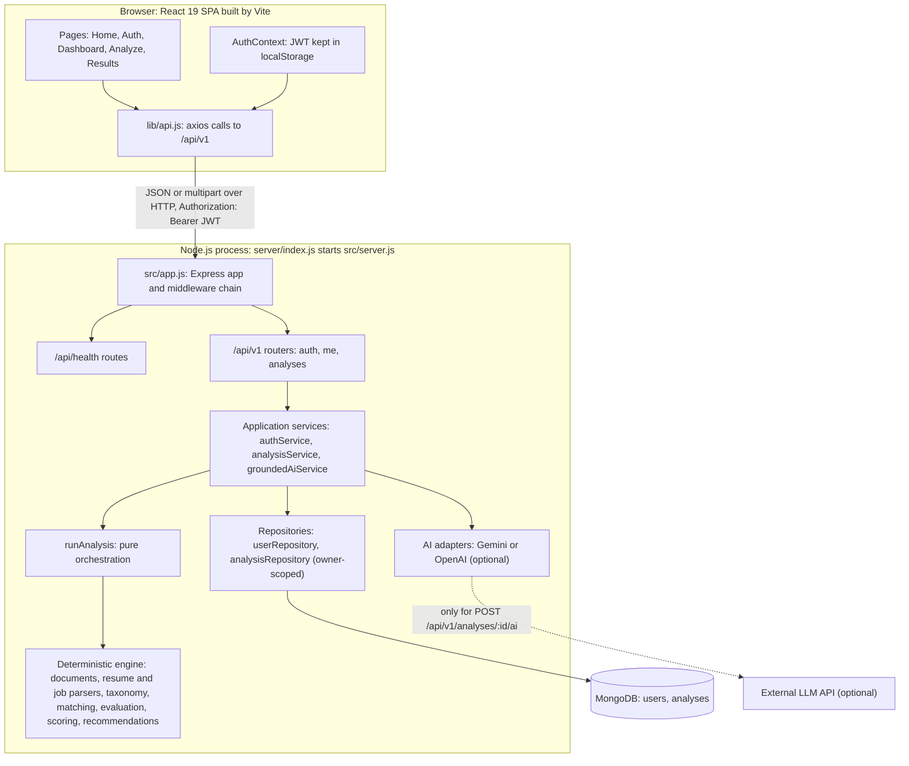
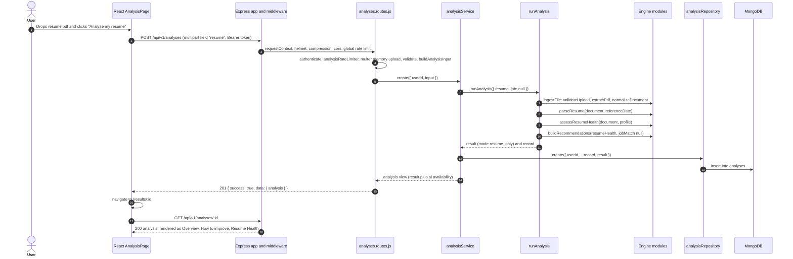
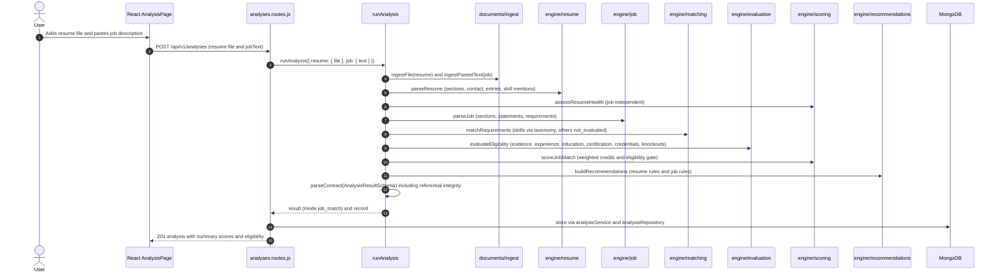
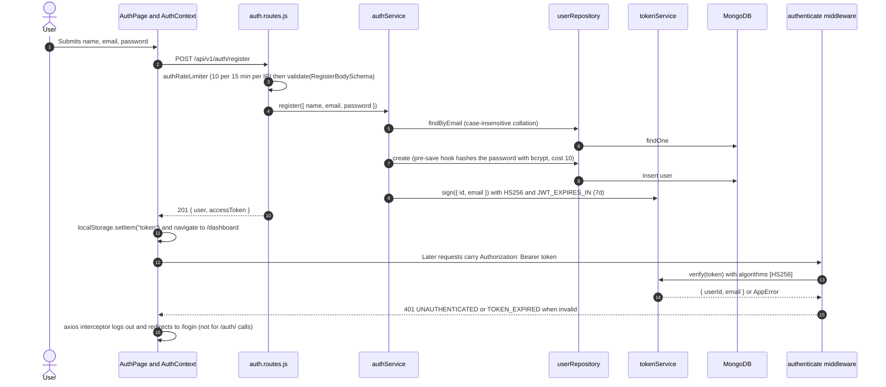
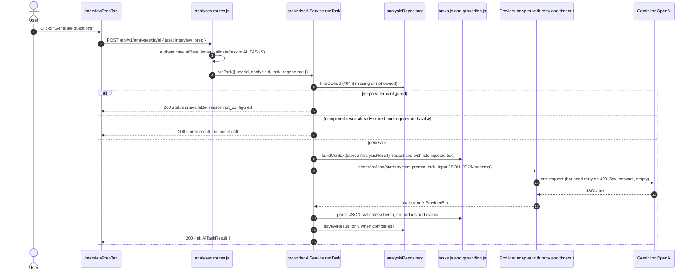
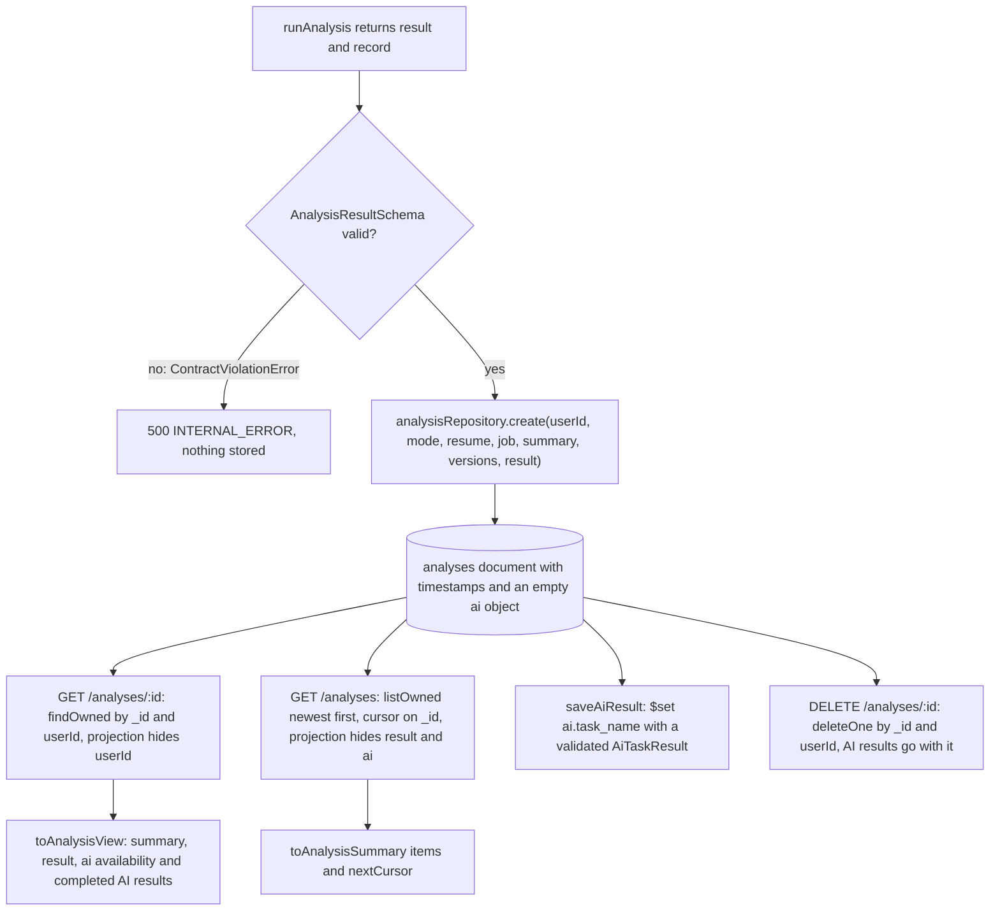
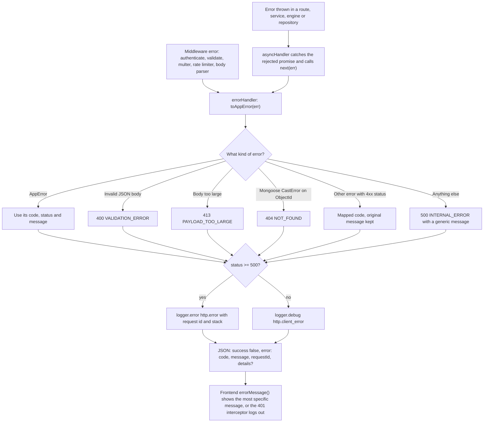
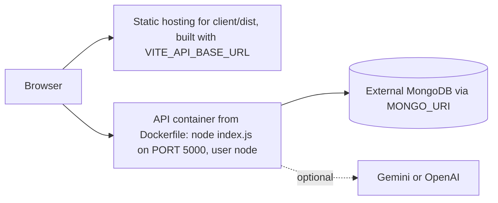

# Architecture

> How the code is organised, how a request flows through it, and why it is split the way it is. Every module and route named here was checked in the repository on 2026-10-20.
>
> Prerequisite: [PROJECT_OVERVIEW.md](PROJECT_OVERVIEW.md). Deeper dives: [ANALYSIS_PIPELINE.md](ANALYSIS_PIPELINE.md), [API_REFERENCE.md](API_REFERENCE.md), [AI_INTEGRATION.md](AI_INTEGRATION.md).

---

## 1. System overview

The system has three runtime pieces: a **React single-page application** (SPA) in the browser, **one Node.js/Express process** (a *modular monolith*, meaning one deployable service internally divided into strict layers), and **MongoDB**. An external AI provider is optional and is contacted only when a user asks for an AI task.

### Diagram 1: overall system architecture



**In plain words:** the browser only ever talks to `/api/v1` (plus health checks). Inside the server, HTTP code calls application services. The analysis service runs the pure engine and then stores the result through a repository. The AI service is a separate, optional path that reads a stored result and calls an external model only on request. The engine itself never touches the database, the network or the clock.

---

## 2. Verified directory tree

Only files that exist are listed. Generated output (`client/dist`), dependencies (`node_modules`) and local data (`.mongo_data/`, `server/uploads/`) are omitted.

```text
ATS/
├── README.md                     Project entry point
├── docs/                         This knowledge base
├── package.json                  Root scripts: dev (concurrently), install-all, build, start
├── Dockerfile                    API-only production image (node:22-slim, non-root)
├── .dockerignore                 Keeps .env files, client, tests, uploads out of the image
├── .github/workflows/ci.yml      Backend tests + frontend build on push/PR
├── API.md, PRODUCTION_CHECKLIST.md          Short earlier docs (superseded by docs/)
├── *_REPORT.md, *_AUDIT.md, brain/          Historical reports (see DEVELOPMENT_HISTORY.md)
│
├── client/                       React frontend (Vite)
│   ├── index.html                HTML shell, Google Fonts links, <div id="root">
│   ├── vite.config.js            React plugin + Tailwind CSS v4 plugin
│   ├── eslint.config.js          Lint rules (flat config)
│   ├── public/favicon.svg
│   └── src/
│       ├── main.jsx              Boots React; sets axios baseURL from VITE_API_BASE_URL
│       ├── App.jsx               Routes (lazy-loaded pages), header, footer, 404
│       ├── index.css             Tailwind import + design tokens (@theme) + component classes
│       ├── context/AuthContext.jsx   Token state, login/logout, getMe(), global 401 handling
│       ├── lib/api.js            The ONLY place that calls the backend (/api/v1)
│       ├── lib/format.js         Labels, dates, score verdict thresholds (80/60)
│       ├── components/
│       │   ├── Header.jsx, Loading.jsx, ProtectedRoute.jsx
│       │   ├── ScoreDisplay.jsx  ScoreRing, ScoreBar, compact score row
│       │   ├── ResumeVisual.jsx  Decorative hero illustration
│       │   └── results/          ScoreOverview, RequirementsTab, ImprovementTab,
│       │                         ResumeHealthTab, InterviewPrepTab
│       └── pages/                HomePage, AuthPage, DashboardPage, AnalysisPage, ResultsPage
│
└── server/                       Express backend
    ├── index.js                  Loads server/.env (dotenv) and calls src/server.js start()
    ├── .env.example              Every supported environment variable, documented
    ├── package.json              Scripts: start, dev (nodemon), test (jest)
    ├── scripts/aiProviderSmoke.js     Manual, opt-in real-provider AI check
    ├── test/
    │   ├── foundation/           All 21 Jest suites (+ helpers/)
    │   └── fixtures/             Fictional resumes and JDs (txt, pdf, docx) + generators
    └── src/
        ├── server.js             Bootstrap: config → logger → DB → app → listen → shutdown
        ├── app.js                createApp(): wires dependencies and middleware (no listen)
        ├── README.md             Layer rules and API conventions
        ├── config/env.js         Zod-validated environment → frozen config object
        ├── shared/errors.js      AppError + the closed set of error codes
        ├── shared/logger.js      JSON logger with key-based redaction
        ├── domain/contracts/     Canonical Zod data contracts (13 files + index.js)
        ├── documents/            Ingestion: fileValidation, extractors/{pdf,docx,text}, normalize, ingest
        ├── engine/               Pure, deterministic analysis
        │   ├── text/             ids, dates, lexicons, jdLexicons, skills (facade)
        │   ├── taxonomy/         data.js (80 skills), taxonomy.js (recognition), version.js
        │   ├── resume/           parseResume, sections, contact, entries
        │   ├── job/              parseJob, sections, statements, requirements, identity
        │   ├── matching/         matchSkills, matchRequirements
        │   ├── evaluation/       evaluate, evidence, experience, education, certification, credentials, support
        │   ├── scoring/          model (weights), breakdown (arithmetic), resumeHealth, jobMatch
        │   ├── recommendations/  recommend, resumeRules, jobRules
        │   └── version.js        ENGINE_VERSION
        ├── application/
        │   ├── auth/             authService (register/login/profile), tokenService (JWT)
        │   ├── analysis/         runAnalysis (orchestration), analysisService (use cases)
        │   └── ai/               aiProvider (port), prompts, grounding, tasks, groundedAiService
        ├── infrastructure/
        │   ├── db/               connection.js, models/User.js, models/Analysis.js
        │   ├── repositories/     userRepository, analysisRepository, ownership
        │   └── ai/               geminiProvider, openaiProvider, createAiProvider, providerErrors
        └── api/
            ├── health.routes.js
            ├── http/respond.js   Success envelope + asyncHandler
            ├── middleware/       requestContext, authenticate, validate, upload, rateLimit, errorHandler
            └── v1/               index.js, auth.routes, me.routes, analyses.routes, schemas/
```

---

## 3. Layers and dependency rules

| Layer | Folder | Responsibility | May depend on |
|---|---|---|---|
| Configuration | `config/` | Read and validate environment variables once; fail fast | `zod` |
| Shared | `shared/` | Error model (`AppError`) and logger | nothing app-specific |
| Domain contracts | `domain/contracts/` | The single source of truth for data shapes | `zod` only |
| Documents | `documents/` | Turn bytes or pasted text into a `NormalizedDocument` | contracts, shared |
| Engine | `engine/` | All analytical decisions. Pure functions only. | contracts |
| Application | `application/` | Use cases: orchestrate the engine, repositories and AI | engine, contracts, repository interfaces |
| Infrastructure | `infrastructure/` | MongoDB models and repositories, AI SDK adapters | `mongoose`, AI SDKs |
| API | `api/` | HTTP only: middleware, routes, request schemas, response envelope | application, shared |

(Source: `server/src/README.md`, checked against the actual `require` calls.)

### Why not one giant function?

The old V2 pipeline had modules that each worked on hand-built test inputs but disagreed about field names at runtime. The September 2026 audit found the real HTTP path scoring 29.67 where a direct call scored 74.34 (`PROJECT_AUDIT_AND_PROBLEM_INVENTORY.md`). The layered design addresses that class of failure:

1. **Contracts at every boundary.** Each stage validates what it produces with `parseContract()` (`server/src/domain/contracts/index.js`). A field-name mismatch now fails loudly as a `ContractViolationError` instead of silently producing zeros.
2. **Pure engine means testable and repeatable.** Parsing, matching, scoring and recommendations are functions of their inputs. They can be unit-tested with exact expected numbers and re-run deterministically.
3. **Replaceable edges.** MongoDB, the AI provider and HTTP are at the edges. Tests swap them with `createApp({ overrides })` and `createAnalysisRunner({ pipeline, now })`.
4. **AI isolation.** Because `runAnalysis` has no AI dependency, a failing or misbehaving model can never alter scores. A test asserts that the pipeline loads no AI client (`analysisPipeline.test.js`, "needs no AI key and loads no AI or network client").
5. **One responsibility per module.** For example, `matchSkills.js` decides whether a skill is present, `evidence.js` decides which text proves it, `jobMatch.js` decides how much that is worth, and `jobRules.js` decides what the user should do about it. Each can change without touching the others, and each records its own version in the result.

---

## 4. Frontend architecture

| Concern | Implementation |
|---|---|
| Bootstrapping | `client/src/main.jsx` renders `<AuthProvider><BrowserRouter><App/><Toaster/></BrowserRouter></AuthProvider>` and sets `axios.defaults.baseURL = import.meta.env.VITE_API_BASE_URL \|\| 'http://localhost:5000'`. |
| Routing | `client/src/App.jsx` uses React Router 7. Routes: `/`, `/login`, `/signup`, `/dashboard`*, `/analyze`*, `/results/:id`*, and `*` (404). \* = wrapped in `ProtectedRoute`. Pages are lazy-loaded with `React.lazy` and `Suspense`. |
| Route protection | `ProtectedRoute.jsx` only checks that a token exists in `localStorage`; it does not validate it. An invalid or expired token is caught by the first API call that returns 401 (see below). |
| Auth state | `AuthContext.jsx` holds `token` (initialised from `localStorage`), `user` (from `GET /api/v1/me`, display only), `login(token)` and `logout()`. A global axios response interceptor logs the user out and redirects to `/login` on any 401 **except** from `/auth/` URLs (a wrong password is not an expired session). |
| API access | `lib/api.js` is the only module that calls the backend: `loginUser`, `registerUser`, `getMe`, `listAnalyses` (`limit: 50`), `getAnalysis`, `deleteAnalysis`, `createAnalysis` (always `multipart/form-data`), `runAiTask`. It also provides `errorMessage()`, which reads the most specific message from the error envelope. |
| State management | Local component state (`useState`, `useEffect`) plus the auth context. No Redux. The open results tab is kept in the URL (`?tab=`), so a refresh keeps the user's place. |
| Rendering results | `ResultsPage.jsx` fetches one analysis and renders tabs. **Overview** (`ScoreOverview`), **Requirements** (job only, `RequirementsTab`), **How to improve** (`ImprovementTab`), **Resume Health** (`ResumeHealthTab`) and **Interview prep** (job only, `InterviewPrepTab`). All panels stay mounted so generated interview questions survive a tab switch. |
| Styling | Tailwind CSS v4 through `@tailwindcss/vite`. Design tokens are declared with `@theme` in `index.css`. Icons come from `lucide-react`. Toasts come from `react-hot-toast`. File drop comes from `react-dropzone`. |
| Business logic | **None.** The frontend never computes scores. It only groups and labels what the API returns. For example, the verdict thresholds in `lib/format.js` are ≥ 80 "Healthy"/"Strong match" and ≥ 60 "Fair"/"Moderate match". |

---

## 5. Backend architecture

### 5.1 Startup and shutdown (`server/src/server.js`)

1. `server/index.js` loads `server/.env` with `dotenv` (using a path relative to the file, so the working directory does not matter) and calls `start()`.
2. `loadConfig(process.env)` validates every variable with a Zod schema (`server/src/config/env.js`). Invalid configuration prints the problems to stderr and exits with code 1. In production, a missing `MONGO_URI`, a `JWT_SECRET` shorter than 32 characters, or the example placeholder secret are fatal.
3. `createLogger({ level })` creates the logger, and configuration warnings are logged (for example "AI features are disabled").
4. `connectDatabase()` connects Mongoose with `serverSelectionTimeoutMS` (default 10 s). Failure is logged as `db.connect_failed` and the process exits with code 1.
5. `createApp({ config, logger })` builds the Express app, and `app.listen(port)` logs `server.started`.
6. On `SIGTERM` or `SIGINT`: stop accepting connections, disconnect MongoDB, exit 0. If that takes more than 10 s, exit 1. Unhandled promise rejections are logged.

### 5.2 Middleware order (`server/src/app.js`)

| # | Middleware | Purpose |
|---|---|---|
| 1 | `requestContext(logger)` | Assigns `req.id` (reuses a well-formed incoming `X-Request-Id`), echoes it in the response, and logs one `http.request` event per response (method, path without query string, status, duration, user id). |
| 2 | `helmet()` | Security headers (CSP, HSTS, `nosniff`, frame options and others). |
| 3 | `compression()` | gzip responses. |
| 4 | `cors({ origin: [allow-list], credentials: true })` | Only origins from `CORS_ORIGINS` or `CLIENT_URL` get CORS headers. |
| 5 | `express.json({ limit })` and `express.urlencoded` | Parse bodies up to `JSON_BODY_LIMIT` (default `10mb`). |
| 6 | `createRateLimiter(global)` on `/api/` | 500 requests per 15 min per IP by default. |
| 7 | `/api/health` router | Liveness and readiness checks. |
| 8 | `/api/v1` router | Auth, me and analyses routes, each with its own route-level middleware. |
| 9 | `notFoundHandler` | Unknown route → `404 NOT_FOUND`. |
| 10 | `createErrorHandler()` | Converts anything thrown into the error envelope. |

Route-level middleware for `POST /api/v1/analyses` runs in this order: `authenticate` → `analysisRateLimiter` → `uploadDocuments` (multer, memory storage) → `validate({ body })` → handler. **Authentication and the rate limit run before the upload is buffered**, so a rejected request never costs memory for the file.

### 5.3 Dependency wiring

`createApp()` constructs every collaborator and accepts `overrides` for tests:

```js
// server/src/app.js (abridged)
const tokenService = overrides.tokenService || createTokenService({ secret, expiresIn });
const analysisRepository = overrides.analysisRepository || createAnalysisRepository();
const aiProvider = overrides.aiProvider !== undefined ? overrides.aiProvider : createAiProvider(config.ai);
const aiService = createGroundedAiService({ provider: aiProvider, analysisRepository, logger, limits });
const analysisService = createAnalysisService({
  runAnalysis: overrides.runAnalysis || createAnalysisRunner(),   // no AI dependency
  analysisRepository,
  describeAi: aiService.describe,                                  // only reports availability
});
```

This is **manual dependency injection** through factory functions (`createX(deps)`), with no DI framework. It is the reason the test suite can run the real HTTP stack with an in-memory database and a scripted AI provider.

---

## 6. Domain contracts

A **contract** here is a Zod schema describing the exact shape of an object that crosses a module boundary. Zod is a TypeScript-first validation library. This project uses its v4 API through the `zod/v4` subpath of `zod@3.25.76`. All objects are **strict** (unknown keys are rejected). Engine outputs use `null` for "looked for, not found" and never omit keys. Ids are deterministic and prefixed (`req_`, `ev_`, `exp_`, `rec_`, `ko_`, `chk_`, `fnd_`, `stm_`, `sec_`, `blt_`, `proj_`, `edu_`, `cert_`), each followed by the first 12 hex characters of a SHA-256 hash (`makeId()` in `server/src/engine/text/ids.js`).

| Contract | File | Produced by | Consumed by |
|---|---|---|---|
| `NormalizedDocument` | `document.js` | `normalizeDocument()` | resume and JD parsers, Resume Health, evidence |
| `ResumeProfile` | `resumeProfile.js` | `parseResume()` | matching, evaluation, Resume Health |
| `JobProfile`, `Statement` | `jobProfile.js` | `parseJob()` | matching, evaluation, Job Match |
| `Requirement` | `requirement.js` | JD parser | everything job-related |
| `Evidence` | `evidence.js` | evidence registry | assessments, knockouts, recommendations, AI |
| `MatchResult`, `RequirementAssessment` | `match.js` | matcher and evaluators | Job Match, recommendations |
| `KnockoutFinding`, `Eligibility` | `eligibility.js` | evaluators | Job Match gate, recommendations |
| `ScoreBreakdown` | `score.js` | `buildBreakdown()` | both scores |
| `ResumeHealthReport` | `resumeHealth.js` | `assessResumeHealth()` | recommendations, UI |
| `Recommendation` | `recommendation.js` | `buildRecommendations()` | UI, AI wording task |
| `AnalysisRequest`, `AnalysisResult` | `analysis.js` | `runAnalysis()` (the request schema is currently unused) | persistence, API, AI |
| `AiTaskResult`, `AiEnrichment` | `ai.js` | `groundedAiService` | API, UI |

Some contracts are **checked invariants** as well as shapes. For example, `ScoreBreakdownSchema` rejects a score that does not equal the sum of its contributions, and `EligibilitySchema` rejects a status that `deriveEligibilityStatus(findings)` would not produce.

Contracts are not the same thing as the MongoDB schemas. See [DATABASE_AND_DATA_MODEL.md](DATABASE_AND_DATA_MODEL.md#6-database-schema-vs-domain-contracts).

---

## 7. Ingestion pipeline (summary)

`file → validateUpload (by bytes) → extractPdf | extractDocx | extractText → normalizeDocument → NormalizedDocument`, or `pasted text → extractPastedText → normalizeDocument`.

Both resumes and job descriptions use the same path (`server/src/documents/ingest.js`). Normalisation is lossless: every line keeps its `original` text for evidence quotes. Full detail: [RESUME_AND_JD_PARSING.md](RESUME_AND_JD_PARSING.md).

## 8. Analysis engine (summary)

`runAnalysis()` in `server/src/application/analysis/runAnalysis.js` calls, in order: ingest resume, ingest job (if any), `parseResume`, `assessResumeHealth`, then for job mode `parseJob` → `matchRequirements` → `evaluateEligibility` → `scoreJobMatch`, and finally `buildRecommendations`. It assembles a contract-validated `AnalysisResult` plus a small `record` of metadata for storage. Each document is ingested and parsed exactly once. Full detail: [ANALYSIS_PIPELINE.md](ANALYSIS_PIPELINE.md).

---

## 9. Sequence diagrams for analysis requests

### Diagram 2: resume-only request



**In plain words:** the browser sends the file and the server checks who you are and how often you have been calling. The file is read in memory, its bytes are validated, and its text is extracted and normalised. The resume is parsed and scored for health, recommendations are built, and the whole validated result is saved and returned. The browser then navigates to the results page, which fetches the stored analysis by id.

### Diagram 3: resume plus job description request



**In plain words:** the job description goes through the same ingestion as the resume, then becomes a list of requirements. Skill requirements are matched against the taxonomy-recognised resume skills. Experience, education, certification, language, work authorisation and clearance are evaluated by dedicated evaluators that also ground every claim in verbatim evidence and record knockout findings. Job Match is then computed from the assessments, with eligibility reported beside it. The final object is validated, including cross-references, before anything is stored.

---

## 10. Authentication and authorisation

### Diagram 4: authentication flow



**In plain words:** registration and login are rate-limited and validated. Passwords are hashed by a Mongoose pre-save hook. The server returns a signed JSON Web Token (JWT): a compact, signed string containing `{ id, email }` and an expiry. The browser keeps it in `localStorage` and sends it as a Bearer header. The `authenticate` middleware verifies the signature and expiry on every protected request and exposes `req.auth.userId`.

**Authorisation (ownership).** Every analysis query includes the caller's user id, for example `findOne({ _id: id, userId })` in `server/src/infrastructure/repositories/ownership.js`. Another user's analysis, a deleted one and a malformed id all produce the same `404 NOT_FOUND`, so the API does not reveal whether an id exists. Details: [SECURITY_AND_PRIVACY.md](SECURITY_AND_PRIVACY.md).

---

## 11. AI integration

### Diagram 5: AI request flow



**In plain words:** AI is a separate, on-demand call against an analysis that already exists. The service builds a minimal, redacted set of facts from the stored result, never the original document, and sends it with a fixed instruction prompt. It then validates the answer three ways: valid JSON, the exact output schema, and grounding (every cited id must exist and be of the right kind, and no new numbers, technologies or names may appear). Only a fully validated result is stored. Every failure becomes an explicit status such as `unavailable` or `failed`, never an HTTP error. Full detail: [AI_INTEGRATION.md](AI_INTEGRATION.md).

---

## 12. Database and persistence

### Diagram 6: analysis persistence flow



**In plain words:** an analysis is stored once as a single MongoDB document. Its `result` field holds the full validated `AnalysisResult`. Small summary fields (`summary`, `versions`, document descriptors) allow the history list to load without the heavy result. AI outputs are added later under `ai.<task>`. Every read, update and delete includes the owner's id. Uploaded files and full document text are never stored. Full detail: [DATABASE_AND_DATA_MODEL.md](DATABASE_AND_DATA_MODEL.md).

---

## 13. Configuration

All configuration comes from environment variables, validated once in `server/src/config/env.js` into a frozen object. Only `config/env.js` and `server.js` read `process.env` (verified by search). Key groups:

| Group | Variables (defaults) |
|---|---|
| App | `NODE_ENV` (development), `PORT` (5000), `LOG_LEVEL` (info; silent in tests) |
| Database | `MONGO_URI` (required in production; dev default `mongodb://127.0.0.1:27017/ats_resume_checker`), `MONGO_SERVER_SELECTION_TIMEOUT_MS` (10000) |
| Auth | `JWT_SECRET` (required), `JWT_EXPIRES_IN` (7d) |
| HTTP | `CLIENT_URL` (http://localhost:5173), `CORS_ORIGINS`, `TRUST_PROXY` (0; required in production), `JSON_BODY_LIMIT` (10mb) |
| Rate limits | `RATE_LIMIT_*` (500/15 min), `AUTH_RATE_LIMIT_*` (10/15 min), `ANALYSIS_RATE_LIMIT_*` (30/15 min), `AI_RATE_LIMIT_*` (30/15 min) |
| AI (optional) | `AI_PROVIDER` (gemini, openai or none), `AI_MODEL`, `GEMINI_API_KEY`, `GEMINI_MODEL`, `OPENAI_API_KEY`, `OPENAI_MODEL`, `AI_TIMEOUT_MS` (20000), `AI_MAX_OUTPUT_TOKENS` (4096), `AI_MAX_RETRIES` (1, max 2) |
| Frontend | `VITE_API_BASE_URL` in `client/.env` (read at build time by Vite) |

The complete table is in [SETUP_AND_USER_GUIDE.md](SETUP_AND_USER_GUIDE.md#a4-environment-variables).

---

## 14. Error handling and logging

### Diagram 7: error-handling path



**In plain words:** route handlers are wrapped by `asyncHandler`, so any rejected promise reaches the single error handler. That handler converts every error into an `AppError` with a stable code from a closed list (`server/src/shared/errors.js`). It logs server errors with their stack, and returns a uniform envelope that always contains the `requestId`, so a user-visible error can be matched to a log line. Internal error messages are never sent to clients, except a `debug` block on 500 errors when `NODE_ENV=development`.

**Logging** (`server/src/shared/logger.js`) writes one JSON object per line to stdout: `{ level, time, event, ...fields }`. Values under sensitive keys are replaced with `"[REDACTED]"` at any depth. Sensitive keys match `pass`, `token`, `secret`, `authorization`, `cookie`, `api key`, `resumeText`, `jobDescription`, `originalText`, `text`, `document`, `email` or `phone`. Events include `http.request`, `http.error`, `config.warning`, `db.connected`, `db.disconnected`, `server.started`, `server.shutdown_*` and `ai.task`.

---

## 15. Deployment architecture



- The **Dockerfile builds the API only**. The frontend is a separate static build. The two are connected through `VITE_API_BASE_URL` (frontend, at build time) and `CLIENT_URL` or `CORS_ORIGINS` (backend).
- MongoDB is external. Nothing is written to the container's disk at run time.
- **Status:** the configuration exists but **has never been built or deployed** from this machine (Docker is not installed), and there is no public deployment URL. See [DEPLOYMENT_AND_OPERATIONS.md](DEPLOYMENT_AND_OPERATIONS.md).

---

## 16. Key architectural decisions, and where they are recorded

| Decision | Rationale | Recorded in |
|---|---|---|
| One-shot `POST /api/v1/analyses` (documents in, stored result out) instead of separate resume and job libraries | Simpler, minimal persistence, no raw text stored | `server/src/application/analysis/README.md`, memory notes from Phase 8 |
| The Job Match score is never capped by a knockout | The score must equal the sum of its contributions; eligibility is a separate signal | `server/src/engine/scoring/README.md`, `runAnalysis.js` comment |
| AI is on demand only, never inside analysis | AI can never alter deterministic results | `server/src/application/ai/README.md` |
| No TypeScript; JavaScript with Zod contracts | The redesign plan proposed TypeScript; the implementation kept CommonJS JavaScript and enforces shapes at run time with Zod | Plan Appendix B (D4) versus the current code |
| No semantic or embedding matching | The legacy embedding matcher was removed; the contract still allows a `semantic` method but nothing produces it | `server/src/domain/contracts/match.js`, `engine/matching/` |
| In-memory rate limits | Adequate for a single instance; no Redis | `server/src/README.md` |
