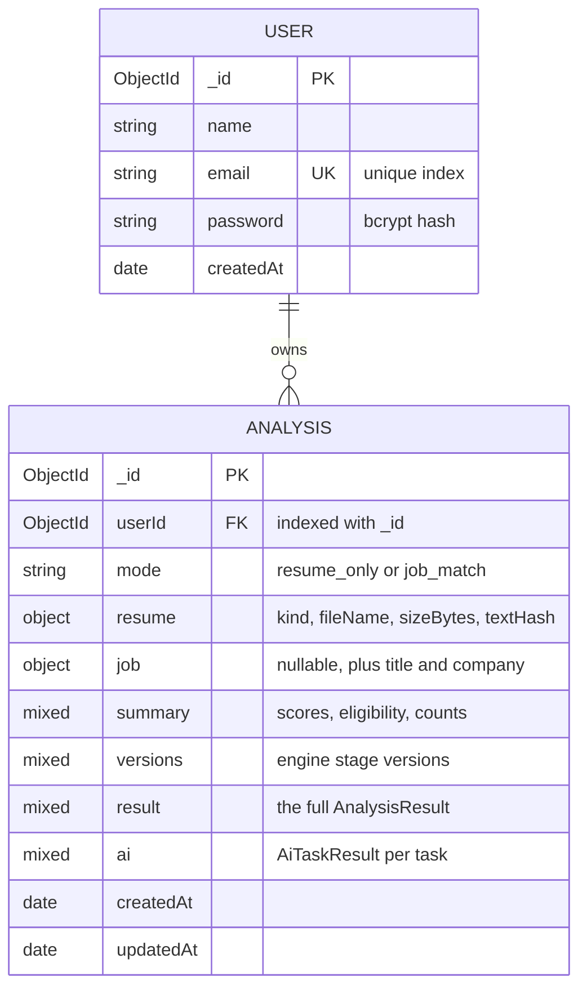

# Database and Data Model

> What is stored in MongoDB, why, and how it is read, updated and deleted. Verified against `server/src/infrastructure/db/models/`, `server/src/infrastructure/repositories/`, and an in-memory MongoDB run on 2026-10-20 that inspected real stored documents and indexes.

---

## 1. Overview

The application uses **two collections**:

| Collection | Mongoose model | Purpose |
|---|---|---|
| `users` | `User` (`infrastructure/db/models/User.js`) | Accounts |
| `analyses` | `Analysis` (`infrastructure/db/models/Analysis.js`, `collection: 'analyses'`) | One document per completed analysis, owned by one user |

There is no foreign-key enforcement (MongoDB has none); ownership is enforced by **always querying with `userId`** (section 4). Deleting a user is not possible through the API, so orphaned analyses cannot arise from the application itself.

---

## 2. `users`

| Field | Type | Required | Notes |
|---|---|---|---|
| `_id` | ObjectId | auto | Exposed as `user.id` |
| `name` | String | yes | Trimmed, 1 to 100 characters (validated by the API, not by the schema) |
| `email` | String | yes, **unique index** | Lower-cased by the API before saving; lookups use a case-insensitive collation (`{ locale: 'en', strength: 2 }`) so old mixed-case records still match |
| `password` | String | yes | **bcrypt hash** (cost 10) set by a `pre('save')` hook; never returned by the API (`toPublicUser()` exposes only `id, name, email, createdAt`) |
| `createdAt` | Date | default `Date.now` | No `updatedAt` (no `timestamps` option) |

Verified on 2026-10-20: stored keys are `_id, name, email, password, createdAt, __v`; the hash matches the bcrypt format `$2a$10$…`; indexes are `_id` and `{ email: 1 }` (unique).

**Duplicate handling:** `authService.register()` first checks `findByEmail()` (case-insensitive); `userRepository.create()` also catches MongoDB duplicate-key error `11000` and maps it to `409 EMAIL_TAKEN`, which covers simultaneous registrations.

**Compatibility:** the legacy (pre-redesign) `User` schema had the same fields, so accounts created before the redesign can still log in.

---

## 3. `analyses`

| Field | Type | Required | Notes |
|---|---|---|---|
| `_id` | ObjectId | auto | The analysis id (also used as the pagination cursor) |
| `userId` | ObjectId (ref `User`) | yes | The owner; **never returned by the API** |
| `mode` | String enum `resume_only`, `job_match` | yes | |
| `resume` | sub-document `{ kind (pdf\|docx\|txt\|paste), fileName (String\|null), sizeBytes (Number\|null), textHash (String, required) }` | yes | `fileName` is a sanitised display name; `textHash` is the SHA-256 of the normalised text |
| `job` | the same descriptor plus `title`, `company`; default `null` | no | `null` in resume-only mode |
| `summary` | Mixed | yes | `{ resumeHealth: { score, readability }, jobMatch: { score, eligibility, hardKnockout } \| null, recommendations: { total, critical, high } }`, enough for the history list without loading `result` |
| `versions` | Mixed | yes | `{ schema, engine, parser, jobParser, taxonomy, matcher, evaluator, scoringModel, recommendations }` |
| `result` | Mixed | yes | The complete, contract-validated `AnalysisResult` |
| `ai` | Mixed, default `{}` | no | `{ <task>: AiTaskResult }`, completed results only |
| `createdAt`, `updatedAt` | Date | auto | `timestamps: true` |

**Schema options:** `minimize: false` keeps empty objects inside `result` (Mongoose would otherwise drop `{}`), so a stored result reads back still contract-valid. This is tested: "returns the stored analysis to its owner, identical to what was created and still contract-valid".

**Index:** `{ userId: 1, _id: -1 }`, which serves "this user's analyses, newest first" (ObjectIds increase with creation time). Verified present on 2026-10-20 together with the default `_id` index.

**Why `Mixed` for `result`?** The canonical shape is owned by the Zod contract (`AnalysisResultSchema`), which is far stricter than a Mongoose schema could express (cross-references, score invariants). Duplicating it in Mongoose would create two sources of truth. The trade-off: MongoDB itself does not validate `result`; the application validates it before writing.

---

## 4. How data is accessed (repositories)

All access goes through `infrastructure/repositories/`:

| Function | Query | Used by |
|---|---|---|
| `userRepository.findByEmail(email)` | `findOne({ email }).collation({ locale: 'en', strength: 2 })` | register, login |
| `userRepository.findById(id)` | `findById(id)`, returning `null` for a non-ObjectId string | `GET /me` |
| `userRepository.create({ name, email, password })` | `create()`; duplicate key → `{ duplicate: true }` | register |
| `analysisRepository.create(analysis)` | `create({ userId, mode, resume, job, summary, versions, result })` → `{ _id, createdAt }` | `POST /analyses` |
| `analysisRepository.findOwned({ userId, id })` | `findOne({ _id: id, userId }, { userId: 0, __v: 0 }).lean()` via `findOwnedById()` | `GET /analyses/:id`, AI tasks |
| `analysisRepository.listOwned({ userId, limit, cursor })` | `find({ userId, _id: { $lt: cursor } }, { result: 0, ai: 0, userId: 0, __v: 0 }).sort({ _id: -1 }).limit(limit).lean()` | `GET /analyses` |
| `analysisRepository.saveAiResult({ userId, id, result })` | `updateOne({ _id: id, userId }, { $set: { ['ai.' + task]: result } })` | AI tasks (completed only) |
| `analysisRepository.deleteOwned({ userId, id })` | `deleteOne({ _id: id, userId })` | `DELETE /analyses/:id` |

**Ownership rule:** every read, update and delete includes the owner's id. `isObjectId()` rejects malformed ids before querying, so "malformed", "missing" and "someone else's" are indistinguishable and all give `404 NOT_FOUND`. Tested in `ownership.test.js` and `analysisApi.test.js` (cross-user GET and DELETE).

**Pagination:** the service asks for `limit + 1` documents; if it gets the extra one, `nextCursor` is the id of the last item returned. Page size is clamped to 1 to 50 (default 20).

**Injection safety:** queries are built only from validated values. Ids must match `^[a-f0-9]{24}$`, and emails and passwords must be strings (Zod), so an operator-injection payload such as `{ "email": { "$gt": "" } }` is rejected with `400` before any query runs. (Mongoose's `strictQuery` option, which `connectDatabase()` also enables, only strips unknown *fields* from filters; the Zod validation is what blocks operator objects.)

---

## 5. Lifecycle of an analysis document

1. **Create:** `runAnalysis()` returns `{ result, record }` → `analysisRepository.create({ userId, ...record, result })`. If the analysis or its contract validation fails, **nothing is written**.
2. **Read:** `findOwned()` → `toAnalysisView(doc, describeAi())`. The stored `result` is returned exactly as written. It is **not recomputed**, so it keeps the engine versions it was produced with.
3. **List:** `listOwned()` → `toAnalysisSummary()` (no `result`, no `ai`).
4. **Enrich:** an AI task stores a validated `AiTaskResult` under `ai.<task>` (replacing any earlier one for that task). This is the only update.
5. **Delete:** `deleteOwned()` removes the whole document, including the AI results. It is permanent; there is no soft delete or trash.

---

## 6. Database schema vs domain contracts

| | Mongoose schema | Zod domain contract |
|---|---|---|
| Purpose | How a document is stored and indexed | The exact shape and rules of data passed between modules and returned by the API |
| Strictness | Loose for `result`, `summary`, `versions` and `ai` (`Mixed`) | Strict: unknown keys rejected, cross-references checked, score invariants enforced |
| When it runs | On insert and update (Mongoose casting and `required`) | At every module boundary (`parseContract()`) and before persistence |
| Files | `infrastructure/db/models/*.js` | `domain/contracts/*.js` |

Some contracts describe things that are **not** stored: `NormalizedDocument`, `ResumeProfile` and `JobProfile` exist only in memory during an analysis. The id-based `AnalysisRequest` contract (with `resumeVersionId` and `jobId`) is **currently unused**, because the API was simplified to a one-shot endpoint.

---

## 7. What is stored, and what is deliberately not

| Stored | Not stored |
|---|---|
| The structured `AnalysisResult` | The uploaded file (it lives in memory only during the request) |
| Evidence **snippets**: single verbatim resume lines of at most 300 characters, only those used as evidence | The full resume and JD text |
| Requirement text from the JD (`sourceText`, at most 300 characters, and `displayName`) | Parsed `ResumeProfile` and `JobProfile` (contact details, all entries) |
| Display file name, size, kind and content hash | File paths, MIME types, IP addresses |
| Account name, email, bcrypt hash | Plain-text passwords, tokens |
| Validated AI outputs | AI prompts and raw model responses |

**Personal data that still exists in a stored result:**

- Evidence snippets can contain personal information if a cited line contains it, for example an employer name in an entry header. From the code: if a JD asks for "GitHub" and the resume's only mention is a GitHub URL on the contact line, that **whole contact line** (with email and phone) becomes an evidence snippet and is stored and displayed. AI requests redact such details; storage does not.
- In job mode, a parsed JD title and company are stored.
- `result.diagnostics.warnings` contain generic messages, not resume text.
- **Resume Health check messages describe counts** ("35 words of text were extracted"). Contact checks report presence only, and their `refs` point at line numbers, not text.

So the stored data is **reduced, not anonymous**. Treat the `analyses` collection as personal data.

---

## 8. Retention and privacy

- No automatic expiry (there is no TTL index). Analyses stay until the user deletes them.
- No account deletion or data export endpoint.
- No encryption at the application level; rely on MongoDB or hosting encryption at rest and TLS in transit (`mongodb+srv` URIs use TLS by default).
- Backups are not configured by the project; they depend on the database host (`PRODUCTION_CHECKLIST.md`: "Backups: NOT READY").

See [SECURITY_AND_PRIVACY.md](SECURITY_AND_PRIVACY.md) for the recommended improvements.

---

## 9. Local development data and leftovers

These are outside the current application but present on the development machine. They were **not opened** during this documentation pass:

| Item | Status |
|---|---|
| `.mongo_data/` (about 205 MB) | A local MongoDB data directory that was committed to git in the past. Its removal from the git index is **already staged** (31 staged deletions); the files still exist on disk, and `.gitignore` now lists `.mongo_data/`. Removing it from git *history* would need a history rewrite (the owner's decision). |
| Legacy collections in the development database (for example `resumes`, `interviewpreps`) | Reported by earlier implementation notes as left over from the V1/V2 app and unused by the current code. Not inspected in this pass. |
| `server/uploads/` (23 files) | Leftover uploads from the legacy disk-storage upload route; likely contain resume content. Ignored by git (`uploads/`) and excluded from Docker. Recommended: delete after review. |
| `server/real-resume.pdf`, `server/dummy.pdf` | Legacy sample files at the server root; ignored by git (`*.pdf`) and excluded from Docker. The name suggests personal data; review and delete. |

---

## 10. Interview summary

> "There are two collections. `users` holds name, a unique lower-cased email and a bcrypt hash. `analyses` holds one document per analysis: the owner's id, small summary fields for the history list, version stamps, the full validated result as a Mixed field, and AI outputs under `ai.<task>`. The Zod contract, not Mongoose, defines the result's shape, so I validate before writing and keep one source of truth. Every query includes the user id, so another user's analysis looks exactly like a missing one: a 404. The compound index on `userId` and `_id` descending serves the history page with cursor pagination. I never store the uploaded file or the full text, only short evidence lines and content hashes."
