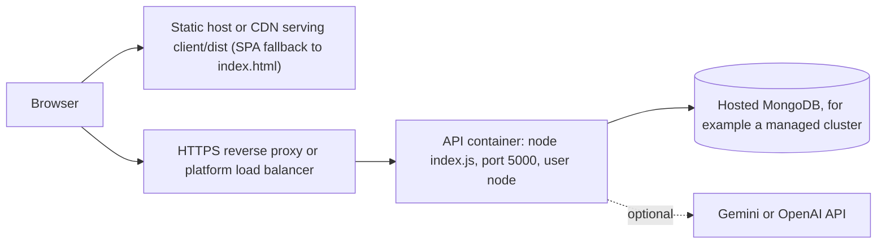

# Deployment and Operations

> How the project is meant to be built, configured, run and monitored in production, and, just as important, **what has and has not actually been verified**. There is no public deployment of the current code and no deployment URL.

---

## 1. Configuration that exists vs what has been verified

| Item | Exists | Verified? |
|---|---|---|
| Backend production start (`NODE_ENV=production node index.js`) | yes | The production *config rules* are tested (refuses a weak secret or a missing `MONGO_URI`). A production run against a real hosted MongoDB was **not** performed. |
| `Dockerfile` (API image) | yes | **Never built**: Docker is not installed on the development machine |
| `.dockerignore` | yes | Contents reviewed; not exercised by a build |
| Frontend static build | yes | **Built successfully** on 2026-10-20 (Vite 7.3.6) |
| Static hosting of the frontend | no configuration in the repository | n/a |
| GitHub Actions CI (`.github/workflows/ci.yml`) | yes | **Not run on the current code as of 2026-10-23** (not yet pushed; `origin/main` was then an older commit from 2026-02-20) |
| docker-compose, Kubernetes, IaC | none | n/a |
| Monitoring and alerting | none | `PRODUCTION_CHECKLIST.md`: "Monitoring: NOT READY" |
| Database backups | none (left to the host) | `PRODUCTION_CHECKLIST.md`: "Backups: NOT READY" |

---

## 2. Target topology



- The frontend and API are deployed **separately**. The frontend knows the API's address at **build time** (`VITE_API_BASE_URL`); the API allows the frontend's origin through `CLIENT_URL` or `CORS_ORIGINS`.
- The API is **stateless** apart from in-memory rate-limit counters (JWT authentication, no server sessions, no files on disk).

---

## 3. Backend

### 3.1 The Dockerfile, line by line

```dockerfile
FROM node:22-slim                    # Debian-based Node 22 (see the note on Node versions)
ENV NODE_ENV=production
WORKDIR /app/server
COPY server/package.json server/package-lock.json ./
RUN npm ci --omit=dev && npm cache clean --force    # exact locked versions, no dev tools
COPY server ./                       # source; .dockerignore removes .env files, tests, scripts, uploads, PDFs
USER node                            # do not run as root
ENV PORT=5000
EXPOSE 5000
HEALTHCHECK --interval=30s --timeout=5s --start-period=20s --retries=3 \
  CMD node -e "fetch('http://127.0.0.1:'+process.env.PORT+'/api/health/live')…"
CMD ["node", "index.js"]
```

What `.dockerignore` excludes: `**/.env` and `**/.env.*` (except `.env.example`), `.git`, `.github`, `.mongo_data`, `**/node_modules`, `**/dist`, `**/build`, `**/coverage`, logs, the whole `client/` and `brain/`, root-level `*.md`, `*.txt` and `*.js`, `server/uploads`, `server/test`, `server/scripts`, and `server/*.pdf`.

Build and run (**not verified**):

```bash
docker build -t ats-api .
docker run -p 5000:5000 --env-file production.env ats-api
```

> **Caution about `--env-file server/.env`.** The root `README.md` previously suggested `docker run … --env-file server/.env`. Do **not** use the local development file for a container. It sets `NODE_ENV=development`, which overrides the image's `production`: the production checks are skipped and 500 errors expose debug details. Its `MONGO_URI` points at `127.0.0.1`, which inside a container is the container itself. Use a dedicated production environment file or the platform's secret store.

Things to confirm on the first real build:

- `pdfjs-dist` 3.x lists `canvas` as an **optional** dependency. `npm ci` will try to install it (it needs native binaries); a failure is tolerated because it is optional, and the app never loads `canvas`.
- The `HEALTHCHECK` uses the global `fetch`, available in Node 18 and later.

### 3.2 Production environment variables (checklist)

| Variable | Requirement |
|---|---|
| `NODE_ENV` | `production` |
| `MONGO_URI` | **Required**, for example `mongodb+srv://…` (TLS) |
| `JWT_SECRET` | **Required**: 32+ random characters, not the placeholder; keep it stable (changing it logs everyone out) |
| `CLIENT_URL` or `CORS_ORIGINS` | The exact frontend origin(s), for example `https://app.example.com` |
| `TRUST_PROXY` | **Required** (production refuses to start without an explicit value): the number of proxies in front of the app (usually 1 behind a platform load balancer; **0** if exposed directly) |
| `PORT` | As required by the platform |
| `LOG_LEVEL` | `info` (or `warn`) |
| Rate limits | Defaults, or tuned values |
| AI (optional) | `AI_PROVIDER`, the key, **`AI_MODEL`**; or `AI_PROVIDER=none` |

### 3.3 Startup, health and shutdown

| Phase | Behaviour |
|---|---|
| Config | Invalid configuration → stderr message, **exit 1** (fail fast) |
| Database | `connectDatabase()` waits up to `MONGO_SERVER_SELECTION_TIMEOUT_MS` (10 s); failure → `db.connect_failed`, **exit 1**. Mongoose creates the model indexes (`users.email` unique; `analyses { userId: 1, _id: -1 }`) automatically. |
| Ready | `server.started` log; `/api/health/live` → 200; `/api/health/ready` → 200 only while MongoDB is connected (503 `NOT_READY` otherwise) |
| Running | Disconnects and reconnects are logged (`db.disconnected`, `db.reconnected`) |
| Shutdown | `SIGTERM` or `SIGINT` → stop accepting connections → close MongoDB → exit 0; forced exit 1 after 10 s |

Use `/api/health/live` for liveness (restart if it fails) and `/api/health/ready` for readiness (stop routing traffic while the database is down).

### 3.4 Logs

- One JSON object per line on **stdout**: `{ "level", "time", "event", … }`. Ship stdout to the platform's log service.
- Key events: `http.request` (method, path without query, status, duration, user id, request id), `http.error` (500s with stack), `config.warning`, `db.*`, `server.*`, `ai.task` (task, status, reason, provider, model, dropped items, duration).
- **Never logged** (by design and tested): passwords, tokens, keys, document text, emails, phone numbers (key-based redaction), query strings, AI prompts and responses.
- Correlate a user's error with the logs using `requestId`, which appears in every error response and the `X-Request-Id` header.

---

## 4. Frontend

```bash
# Set the API origin at BUILD time (Vite inlines it into the bundle)
VITE_API_BASE_URL=https://api.example.com npm run build --prefix client
# Output: client/dist (index.html + assets/)
```

- Host `client/dist` on any static host or CDN.
- **SPA fallback is required.** The app uses `BrowserRouter`, so a page reload on `/dashboard` or `/results/<id>` must serve `index.html`. Configure the host to rewrite unknown paths to `/index.html`; otherwise those URLs return the host's 404.
- Fonts load from Google Fonts at run time (a third-party request); without network access the system fonts are used.
- Build result on 2026-10-20: 1,748 modules; main bundle 299.22 kB (100.41 kB gzip); CSS 53.80 kB (8.77 kB gzip). Routes are code-split (`React.lazy`).

---

## 5. MongoDB

- Use a hosted MongoDB with authentication, TLS and a network allow-list.
- Two collections: `users` and `analyses` ([DATABASE_AND_DATA_MODEL.md](DATABASE_AND_DATA_MODEL.md)).
- **Backups:** not configured by the project. Use the host's backups or scheduled `mongodump`. Losing the database loses accounts and all stored analyses (the original documents were never stored, so they cannot be re-analysed from the database).
- **Retention:** no TTL; data grows until users delete analyses. Each analysis document holds the full result. Measured on the worked example: about **28 KB** of JSON for a job-match result (11 requirements) and about **5 KB** for a resume-only result. Larger JDs produce larger results; storage has not been measured at scale.

---

## 6. CI pipeline (`.github/workflows/ci.yml`)

Triggers: push and pull requests to `main` or `master`.

| Job | Steps |
|---|---|
| `backend` | Checkout → Node from `.nvmrc` (22.20.0) with npm cache → `npm ci --prefix server` → `npx jest --runInBand` with `NODE_OPTIONS=--max-old-space-size=4096`, a CI-only `JWT_SECRET` and `AI_PROVIDER=none` |
| `frontend` | Checkout → Node from `.nvmrc` (22.20.0) → `npm ci --prefix client` → `npm run build --prefix client` |

No real database or API keys are needed (in-memory MongoDB, scripted AI).

**Before relying on CI:**

1. The PDF test fixtures must be in the commit, or four suites will fail on a fresh checkout. `*.pdf` is ignored, but `.gitignore` now has explicit exceptions for the three fixtures (see [TESTING_AND_VALIDATION.md §5](TESTING_AND_VALIDATION.md#5-fixtures)).
2. Consider adding `npm run lint --prefix client` (it passes today) and `npm audit --omit=dev`.
3. Both jobs read the Node version from `.nvmrc` (22.20.0). The test suite and the frontend build passed locally on Node 22.20.0 (2026-10-23), but the workflow has not yet run on GitHub's Linux runners.

---

## 7. Production security checklist

Summarised from [SECURITY_AND_PRIVACY.md](SECURITY_AND_PRIVACY.md):

- [ ] HTTPS only (platform TLS or a reverse proxy)
- [ ] `NODE_ENV=production`, a strong `JWT_SECRET`, `MONGO_URI` from a secret store
- [ ] `TRUST_PROXY` matches the real proxy count (prevents rate-limit bypass)
- [ ] `CLIENT_URL` or `CORS_ORIGINS` set to the real frontend origin only
- [ ] No `.env` files in the image (`.dockerignore`, to verify on the first build)
- [ ] `npm audit --omit=dev` reviewed (`proxy-addr` patched to 2.0.8; `pdfjs-dist` upgrade plan)
- [ ] Database backups configured on the host
- [ ] Privacy notice for users (what is stored; AI data transfer)
- [ ] Remove stale keys from all environment files; rotate any key that was ever exposed

---

## 8. Common deployment failures

| Symptom | Cause | Fix |
|---|---|---|
| Container exits immediately with "Invalid configuration" | Missing `MONGO_URI` or a weak or placeholder `JWT_SECRET` in production | Provide proper variables |
| `db.connect_failed` (server selection timeout) | Wrong URI, the database IP allow-list blocks the platform, or `127.0.0.1` used inside a container | Fix the URI or allow-list |
| Frontend loads but API calls fail with CORS errors | `CLIENT_URL`/`CORS_ORIGINS` does not exactly match the frontend origin | Set the exact origin, including scheme |
| API calls go to `http://localhost:5000` in production | `VITE_API_BASE_URL` was not set at build time | Rebuild the frontend with it |
| Refreshing `/dashboard` gives a 404 | No SPA fallback on the static host | Rewrite unknown paths to `index.html` |
| Everyone is logged out after a deploy | `JWT_SECRET` changed | Keep the secret stable |
| Rate limits too strict or too loose behind a load balancer | Wrong `TRUST_PROXY` (all users share one IP, or clients can spoof) | Set it to the real hop count |
| AI always "unavailable" | `AI_MODEL` (or the key) not set, or the model is retired | Configure a current model; check the `config.warning` log |
| Health check failing | The process is not listening on `PORT`, or startup failed | Inspect the startup logs |
| CI fails with `ENOENT … .pdf` | The PDF fixtures were never committed | Commit them (see section 6) |

---

## 9. Dependency management

- Use `npm ci` (exact versions from the lockfiles) in CI and images; all three lockfiles agree with their `package.json` (checked 2026-10-20).
- `npm audit` snapshot (2026-10-20): client production 0; server production 8 (see [TECH_STACK.md §7](TECH_STACK.md#7-dependency-health-snapshot-npm-audit-run-2026-10-20-read-only)).
- Node version: pinned to 22.20.0 (`.nvmrc`; `engines` `>=22.20.0 <23`); Docker uses `node:22-slim` and CI reads `.nvmrc`. Validated locally with a portable Node 22.20.0 on 2026-10-23; the machine's default Node is still 20.14.0, below the project's minimum.

---

## 10. Scaling notes

- **Horizontal scaling** works for authentication and data (stateless JWT, a shared MongoDB), but the **rate limits are per instance** (in memory). With N instances, the effective limit is N times higher. A shared store (for example Redis via a rate-limit store) would be needed for strict limits.
- **Analysis is synchronous and CPU-bound** (about 0.1 s for a small resume and JD in one measurement; larger PDFs take longer). There is no queue. Under heavy load, consider worker threads or a job queue, but only after measuring.
- **AI calls** take seconds and are bounded by `AI_TIMEOUT_MS` (20 s) and the retry policy.
