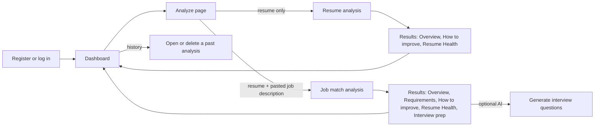

# Project Overview

> **Read this first.** It explains what ATS Resume Checker is, why it was built this way, and what it deliberately does not do. Implementation details live in the other documents; this one gives you the mental model that the rest of the documentation hangs on.
>
> Status labels used in this knowledge base are defined in [docs/README.md](README.md#how-to-read-status-labels).

---

## 1. The project in one paragraph

ATS Resume Checker is a MERN web application (MongoDB, Express, React, Node.js). A signed-in user uploads a resume (PDF, DOCX or TXT) or pastes its text, and can optionally paste a job description. A **deterministic, rule-based analysis engine** then produces two separate results:

- **Resume Health**: how readable, complete, structured and well-evidenced the resume is on its own.
- **Job Match** (only when a job description is supplied): how strongly the resume's evidence meets each requirement in that job description, with the exact resume lines used as evidence and a separate eligibility verdict.

Every point lost in either score is traceable to a named check or requirement, and every recommendation is traceable to a finding. An **optional AI layer** (Gemini or OpenAI) can afterwards generate interview-preparation material and explanations from the stored result, but it can never change a score, a status or a recommendation.

**Implementation:** backend `server/src/`, frontend `client/src/`. Entry points: `server/index.js` and `client/src/main.jsx`.

---

## 2. The problem it addresses

### 2.1 What an ATS is

An **Applicant Tracking System (ATS)** is software that employers use to collect applications, store resumes and help recruiters search and filter candidates. Typical ATS behaviour includes:

1. **Parsing**: converting the uploaded file into text and then into structured fields (name, roles, dates, skills).
2. **Searching and ranking**: recruiters search for terms such as "React" or filter by years of experience.
3. **Knockout questions**: hard filters such as "Are you authorised to work in this country?".

If parsing fails, for example because of an image-only PDF or a two-column layout read out of order, a recruiter may never see the resume's real content.

### 2.2 Why ordinary keyword checking is not enough

Many "ATS checker" tools count how many words from the job description appear in the resume. That approach has well-known problems, and this project's design responds to each of them:

| Problem with naive keyword matching | How this project responds | Where |
|---|---|---|
| Substring matching confuses technologies ("Java" inside "JavaScript", "C" inside "C++", "React" inside "React Native"). | A curated skill **taxonomy** with boundary-safe matching and explicit "never equivalent" pairs. | `server/src/engine/taxonomy/` |
| A word in a skills list counts the same as a skill used in a real role. | **Evidence strength**: experience bullets are `strong`, projects `moderate`, skills lists `weak`. | `server/src/engine/matching/matchSkills.js` |
| Every JD word is treated as equally important. | Requirements are classified as `required`, `preferred` or `contextual` and weighted 1, 0.3 and 0.15. | `server/src/engine/job/requirements.js`, `server/src/engine/scoring/model.js` |
| A missing word is treated as proof that the candidate lacks the skill. | **"Absence of evidence is not evidence of failure."** Uncertain cases are `insufficient_evidence` or `unknown`, never automatic failures. | `server/src/engine/evaluation/` |
| One opaque number with no explanation. | Every score is a `ScoreBreakdown` in which the score plus all deductions equals exactly 100. | `server/src/domain/contracts/score.js` |
| Eligibility problems (for example a required security clearance) are mixed into the score. | Eligibility is a **separate verdict** (`clear`, `review` or `likely_filtered`) that never changes the score. | `server/src/domain/contracts/eligibility.js` |

### 2.3 ATS compatibility, resume quality and hiring outcomes are different things

Keep these three ideas separate. Interviewers often probe this distinction.

| Concept | What it means | Does this project measure it? |
|---|---|---|
| **ATS compatibility (parseability)** | Can software extract the text and structure correctly? | **Partly.** The `parseability` component of Resume Health checks the text layer, encoding, icon glyphs, reading order, headings, length and embedded instructions. It does **not** run any real employer's ATS. |
| **Resume quality** | Is the content complete, structured and evidenced (dated roles, bullets, measurable results, named skills)? | **Yes, by fixed rules.** These are the other four Resume Health components. |
| **Job fit** | Does the resume show evidence for this job's explicit requirements? | **Yes, by rules.** Job Match covers explicit, extractable requirements only. |
| **Hiring outcome** | Will the person get an interview or an offer? | **No.** Nothing in this project predicts that. The engine says so in its own output (`resumeHealth.limitations`, in `server/src/engine/scoring/resumeHealth.js`). |

Never claim that the application reproduces "the" ATS used by employers, or that a high score guarantees a call-back. There are many ATS products, each configured differently, and human recruiters make the decisions.

---

## 3. Who it is for

| User | Typical use |
|---|---|
| Students and early-career job seekers | Check whether a resume is readable and complete before applying. |
| Applicants targeting a specific role | Paste the job description to see requirement-by-requirement evidence and gaps. |
| Anyone preparing for interviews | Generate interview questions tied to the job's requirements and the resume's own evidence (optional AI). |
| Developers and interviewers reviewing the code | Study a deterministic, explainable scoring engine with strict data contracts and a grounded AI boundary. |

It is **not** a recruiter tool: there is no candidate ranking or comparison of applicants, by design (see [Non-goals](#11-scope-and-non-goals)).

---

## 4. Main workflows

1. **Resume-only analysis.** Upload or paste a resume and get a Resume Health score, readability checks, content findings and prioritised improvements.
2. **Resume + job description analysis.** Everything above, plus the Job Match score, every extracted requirement with its status and evidence quote, eligibility concerns, and job-specific recommendations.
3. **Interview preparation (optional AI).** For job-match analyses only, generate revision topics and questions tied to requirement or evidence ids. This needs AI to be configured.
4. **History.** Every analysis is saved and listed on the dashboard (the 50 most recent). Each can be reopened or permanently deleted.

Details: [FEATURES_AND_WORKFLOWS.md](FEATURES_AND_WORKFLOWS.md).

---

## 5. Core product principles

These principles were decided during the backend redesign and are enforced in code and tests, not just stated:

1. **Deterministic core.** The same documents on the same reference day always give the same result. The engine has no randomness, no network, no database and no wall-clock reads. The reference date is injected (`createAnalysisRunner({ now })` in `server/src/application/analysis/runAnalysis.js`). This is verified by tests such as `analysisPipeline.test.js` ("is deterministic for the same inputs and reference date"), and was re-checked in this documentation pass.
2. **Evidence first.** A requirement can only be `met` or `partially_met` if it points at real, verbatim resume text. The contract rejects anything else (`RequirementAssessmentSchema` in `server/src/domain/contracts/match.js`).
3. **Absence is not failure.** If the resume does not say something (a clearance, work authorisation, a degree), the result is `insufficient_evidence` or `unknown`, never `failed`. A missing skill is never turned into a knockout.
4. **Eligibility is separate from the score.** Hard requirements are reported in `eligibility`, and a knockout never caps or changes the Job Match number.
5. **Truthful edits only.** Recommendations never tell the user to add a skill, credential, date or number outright. Any suggestion to add content carries an `integrityNote` such as "Only add Java if it truthfully reflects your experience."
6. **AI at the edge.** AI runs only on request, after the analysis is stored, reads only that stored result, and is checked by deterministic grounding guards. The analysis pipeline has no AI dependency at all.
7. **Privacy by default.** Uploaded files and full document text are **not stored**. Only the structured result, short evidence snippets (at most 300 characters each), metadata and content hashes are kept.

---

## 6. Resume Health versus Job Match

| | Resume Health | Job Match |
|---|---|---|
| Question answered | "How readable, complete, structured and well-evidenced is this resume on its own?" | "How strongly does the resume's evidence meet this job's explicit requirements?" |
| Needs a job description? | No. It is always computed. | Yes. It is `null` without one. |
| Inputs | Normalised document and parsed resume profile only | Parsed JD requirements, requirement assessments, evidence |
| Components | parseability 25%, structure 20%, technical content 25%, impact 15%, completeness 15% | required skills, preferred skills, experience, education, certifications, responsibilities (weights come from the requirements themselves) |
| Can it be `null`? | Yes, when fewer than 20 words are extracted (the resume is "unreadable"). | Yes, when the JD has no scoreable requirements. |
| Implementation | `assessResumeHealth()` in `server/src/engine/scoring/resumeHealth.js` | `scoreJobMatch()` in `server/src/engine/scoring/jobMatch.js` |

The two numbers are **never blended**. A well-written resume can have high health and a low match for a particular job, and the reverse. Full formulas: [SCORING_AND_MATCHING.md](SCORING_AND_MATCHING.md).

---

## 7. Why the job description is optional

- Many users simply want to know whether their resume is in good shape before they have a specific job in mind.
- Forcing a JD would push users to paste random postings and get meaningless match scores.
- The contracts model this explicitly. `AnalysisResult.mode` is either `resume_only` (with `job: null` and `jobMatch: null`) or `job_match`. "No job" is a valid state, not an error (`server/src/domain/contracts/analysis.js`).
- In `resume_only` mode the engine does not parse a job, does not compute Job Match and does not produce job-scoped recommendations. The contract rejects a resume-only result that carries job data.

---

## 8. Why deterministic analysis is separate from AI-generated explanations

| Concern | Deterministic engine | LLM (AI provider) |
|---|---|---|
| Repeatability | Same input gives the same output | Output varies between calls and model versions |
| Explainability | Every point lost is tied to a rule and a requirement | Hard to audit why a number was chosen |
| Hallucination | Cannot invent facts; only reads the document | Can invent skills, numbers or employers |
| Cost and availability | Free and local; works offline | Paid, rate-limited, sometimes unavailable (503s and rate limits were seen during earlier validation) |
| Testability | Unit-tested with exact expected values | Needs scripted fakes in tests |

So the engine decides **everything that matters**: requirements, statuses, evidence, eligibility, scores, recommendations and priorities. AI is limited to **explaining and rewording** a stored result, and its output is validated against that result before it is kept. Details: [AI_INTEGRATION.md](AI_INTEGRATION.md).

---

## 9. What makes the implementation technically interesting

These are the strongest talking points, all traceable to code:

1. **Strict data contracts** (Zod schemas with unknown keys rejected) validated at every module boundary with `parseContract()`, including cross-reference integrity checks: every evidence id, requirement id and finding id referenced anywhere in a result must exist (`checkReferentialIntegrity()` in `server/src/domain/contracts/analysis.js`).
2. **A layered, boundary-safe taxonomy matcher** that keeps Java and JavaScript, C, C++ and C#, and React and React Native distinct, and treats "PostgreSQL implies SQL" as *partial* credit (0.9), never as equality.
3. **An explainable scoring model** in which the score equals the sum of its component contributions, the score plus all deductions equals 100, and components with nothing to evaluate are excluded rather than given free points.
4. **Eligibility and knockout logic** with a single derivation rule (`deriveEligibilityStatus()`) and conservative policies (explicit statements only).
5. **Grounded AI**: a provider port with two adapters, static prompts, untrusted data wrapped as JSON, native structured output, deterministic grounding checks (typed id references and unsupported-claim detection), prompt-injection withholding and contact-detail redaction.
6. **A lossless ingestion pipeline** that validates files by their bytes (magic numbers), not their names, keeps every original line verbatim for evidence, and refuses oversized input instead of silently truncating it.
7. **Testability by design**: `createApp({ overrides })` and `createAnalysisRunner({ pipeline, now })` allow dependency injection, so tests run the real middleware stack against an in-memory MongoDB with scripted AI providers.

---

## 10. What the project produces, in numbers (verified 2026-10-20)

From a fictional end-to-end run documented in [ANALYSIS_PIPELINE.md](ANALYSIS_PIPELINE.md#3-worked-example):

- Resume Health **100** (a clean, fully structured resume)
- Job Match **77.9**, eligibility **review** (work authorisation not stated), from 11 extracted requirements: 8 scored, 2 responsibilities not evaluated, and 1 work-authorisation requirement reported only through eligibility
- 6 recommendations (3 high, 1 medium, 2 low), each tied to a requirement or finding

The backend test suite (21 suites, 433 tests) passed in this documentation pass. See [TESTING_AND_VALIDATION.md](TESTING_AND_VALIDATION.md).

---

## 11. Scope and non-goals

### In scope today

- Email and password accounts with JWT authentication
- PDF (text-based, up to 15 pages), DOCX and TXT upload, or pasted text
- Optional pasted job description (the API also accepts a JD file; the UI pastes only)
- Resume Health, Job Match, requirement evidence, eligibility and knockouts, recommendations
- Optional AI interview preparation in the UI (four more AI tasks exist in the API only)
- Analysis history with delete

### Deliberate non-goals

| Not done | Why |
|---|---|
| OCR for scanned or image-only PDFs | Heavy dependencies and accuracy risk. A clear `422` error is returned instead. |
| Predicting hiring outcomes or ranking candidates | Fairness risk; not what this product measures |
| Letting an LLM compute scores | Not repeatable, not explainable, can hallucinate (see section 8) |
| Scraping job postings from URLs | Terms-of-service risk and brittleness |
| Broad, non-software skill coverage | The taxonomy is deliberately small (80 skills) and accurate rather than large and loose |

### Removed during the legacy cleanup (Phase 11, 2026-10-04)

PDF report export, the AI bullet optimizer and saved resume versions, the learning roadmap, project relevance, multi-JD "job sets", Google sign-in and the bias dashboard. These were deleted together with the legacy V1/V2 backend and are **not available** in the current application. Evidence is in [FEATURES_AND_WORKFLOWS.md](FEATURES_AND_WORKFLOWS.md#10-removed-features) and [DEVELOPMENT_HISTORY.md](DEVELOPMENT_HISTORY.md).

---

## 12. Current status in brief

- **Working and verified:** the backend engine, API, persistence, ownership rules and AI guards (automated tests, re-run 2026-10-20), and the frontend lint (re-run 2026-10-20). Browser flows were verified on 2026-10-05 by earlier reports and were not re-run now.
- **Requires configuration:** AI. The local `server/.env` sets `AI_PROVIDER=gemini` and a key, but **no `AI_MODEL`**, so AI is disabled until a model id is set.
- **Known limitations:** PDF structure reconstruction lowers Resume Health compared with the same DOCX; some plain English words ("rest", "express", "node", "swift") are recognised as skills; a JD that *offers* visa sponsorship can wrongly create a work-authorisation knockout; and the Docker image has never been built here. (The PDF test fixtures, previously hidden by `.gitignore`, are now included through explicit exceptions.)
- **Not yet published (as of 2026-10-23):** the redesigned backend and frontend had not been pushed to GitHub, so CI had not run on them; `origin/main` was then `6509f03` (2026-02-20).

Full inventory and priorities: [KNOWN_LIMITATIONS_AND_ROADMAP.md](KNOWN_LIMITATIONS_AND_ROADMAP.md).

---

## 13. Where to go next

| If you want to… | Read |
|---|---|
| Understand the structure of the code | [ARCHITECTURE.md](ARCHITECTURE.md) |
| Follow one analysis from upload to screen | [ANALYSIS_PIPELINE.md](ANALYSIS_PIPELINE.md) |
| Understand every formula | [SCORING_AND_MATCHING.md](SCORING_AND_MATCHING.md) |
| Prepare for interviews | [INTERVIEW_PREPARATION.md](INTERVIEW_PREPARATION.md) |
| Run the project | [SETUP_AND_USER_GUIDE.md](SETUP_AND_USER_GUIDE.md) |
