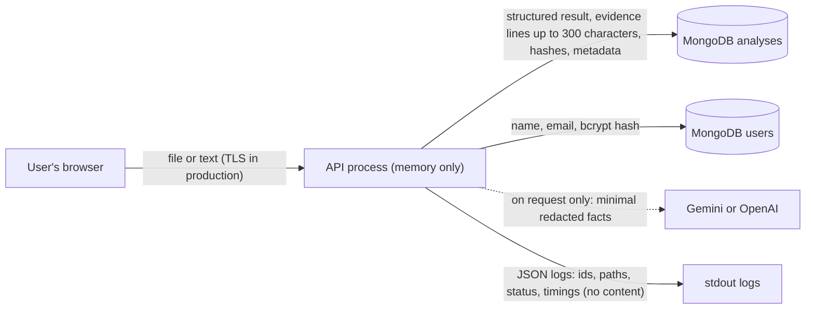

# Security and Privacy

> What protections exist, how each was verified, and what is still missing. This is **not** a claim that the application is secure; it is an honest inventory for a student project that handles personal documents. No secrets were printed while preparing it (environment files were inspected by variable *names* only).
>
> Labels used: **Verified** (automated tests and/or a probe run on 2026-10-20) · **Partially verified** · **Unverified** (configuration exists but was never exercised) · **Missing**.

---

## 1. What needs protecting

| Asset | Threats considered |
|---|---|
| User accounts | Password theft, credential stuffing and brute force, token forgery or theft |
| Resumes, job descriptions and analyses (personal data) | Another user reading or deleting them (IDOR), leakage through logs, storage or AI providers |
| The server | Malicious uploads (fake types, zip bombs, malicious PDFs), oversized input, request floods |
| Secrets (JWT secret, AI keys, database URI) | Leakage through the repository, Docker images, logs or error messages |
| AI usage | Prompt injection through documents, cost abuse, model output being trusted |

*IDOR* (Insecure Direct Object Reference) means accessing someone else's record by changing an id in the URL.

---

## 2. Controls inventory

### 2.1 Authentication and sessions

| Control | Implementation | Status |
|---|---|---|
| Password hashing | bcrypt (bcryptjs), cost 10, in the `User` pre-save hook | **Verified**: tests ("creates a user with a hashed password…"); the stored hash has the format `$2a$10$…` |
| 72-byte password limit | Register rejects passwords over 72 UTF-8 bytes instead of letting bcrypt silently ignore the rest | **Verified** (`apiConventions.test.js`) |
| Generic login failure | The same `401 INVALID_CREDENTIALS` for an unknown email and a wrong password; a dummy bcrypt comparison equalises timing | **Verified** (`auth.test.js`) for the response; timing equalisation from code reading |
| JWT signing and verification | HS256 only (`algorithms: ['HS256']`, which rejects the `none` algorithm); expiry (`JWT_EXPIRES_IN`, default 7 days); the payload `id` must be a 24-character hex ObjectId | **Verified** (`auth.test.js`: expired, wrong secret, malformed, `none` algorithm, missing id, deleted account) |
| Secret strength | Production refuses `JWT_SECRET` shorter than 32 characters or equal to the `.env.example` placeholder | **Verified** (`configAndLogging.test.js`) |
| Local development secret | The local `server/.env` secret is **20 characters**: accepted in development with a startup warning, and it would be rejected in production | Observed (length only) |
| Token storage in the browser | `localStorage`, sent as a Bearer header | Implemented. **Risk:** any XSS on the page could read the token. Mitigations: React escapes rendered text, and there is no `dangerouslySetInnerHTML`, `innerHTML` or `eval` in `client/src` (searched). An httpOnly cookie would remove this risk but brings CSRF considerations. |
| Logout and revocation | Client-side only (the token is deleted from `localStorage`) | **Missing**: a stolen token stays valid until it expires (7 days); no refresh-token rotation, no deny list |
| Password policy | Minimum 8 characters, nothing else | Partial: no complexity rule or breached-password check |
| Email verification, password reset, account deletion | n/a | **Missing** |
| Brute-force protection | Auth limiter: 10 requests per 15 min per IP | **Partially verified**: works, but can be bypassed when `TRUST_PROXY` is wrong (2.3); no per-account lockout |

### 2.2 Authorisation

| Control | Implementation | Status |
|---|---|---|
| Owner-scoped data access | Every analysis query includes `userId` (`findOwnedById()`, `listOwned()`, `saveAiResult()`, `deleteOwned()`) | **Verified**: `ownership.test.js`, `analysisApi.test.js` (another user's GET and DELETE → 404, analysis left intact), `aiApi.test.js`; and over HTTP on 2026-10-20 |
| No existence leak | A foreign, missing or malformed id all give the same `404 NOT_FOUND` | **Verified** |
| No owner id in responses | `toAnalysisView()` and the projections drop `userId` | **Verified** (stored document inspection) |
| Mass assignment | Strict Zod schemas reject unknown fields (`isAdmin` → `400`) | **Verified** (`apiConventions.test.js`, HTTP trace) |
| Roles and admin | None exist; every user has the same rights over their own data | n/a |

### 2.3 Rate limiting and abuse

| Control | Implementation | Status |
|---|---|---|
| Global limit | 500 requests per 15 min per IP on `/api/*` | **Verified** (tests) |
| Auth, analysis and AI limits | 10, 30 and 30 per 15 min per IP | **Verified** (`auth.test.js`, `analysisApi.test.js`, `aiApi.test.js`) |
| Correct client IP | `app.set('trust proxy', TRUST_PROXY)`; default **0** outside production; production refuses to start without an explicit value, and blank or invalid values are rejected | **Fixed (2026-10-23) and covered by the `rateLimitProxy` regression tests** (rotating spoofed headers, limit enforcement, a trusted-proxy case); passing locally. Earlier verified finding: with the former default `TRUST_PROXY=1` and **no** proxy in front, sending a different `X-Forwarded-For` value per request bypassed the login limiter (12 failed logins, no `429`); with `TRUST_PROXY=0`, the 11th request got `429`. **Set `TRUST_PROXY` to the real number of proxies in front of the app (0 if none);** the hop count on the real hosting platform is not yet verified. |
| Store | In-memory; resets on restart; not shared between instances | By design for one instance; scaling out would need a shared store (for example Redis) |
| Upload and body size | Multer 10 MB per file, 2 files, 10 fields of 1 MB; JSON body 10 MB (`JSON_BODY_LIMIT`) | **Verified** (413 tests) |

### 2.4 Input validation and file handling

| Control | Implementation | Status |
|---|---|---|
| Schema validation at the boundary | `validate()` with strict Zod schemas for body, params and query; handlers read only `req.validated` | **Verified** |
| Text never altered | Request schemas do not trim, strip or truncate; over-long text → `413` | **Verified** (`analysisApi.test.js`) |
| File type by content | `%PDF-`, DOCX ZIP structure, or plain text; the client MIME type and file name are not trusted | **Verified** (`documents.test.js`; a PNG named `.pdf` → `415` over HTTP) |
| Size and page limits | 10 MB files, 1 MB text files, 15 PDF pages, 100,000 and 30,000 character limits | **Verified** |
| DOCX zip-bomb guard | Rejects archives declaring more than 10 MB of XML, before decompression | **Verified** (test); **limitation:** it trusts declared sizes (a lying archive is bounded only by the other limits; untested) |
| Malicious PDF | pdf.js with `isEvalSupported: false` (the documented mitigation for the arbitrary-JavaScript advisory against pdf.js ≤ 4.7.76); fonts not loaded (`disableFontFace`); text extraction only, no rendering | **Partially verified**: the option is present in the code; `npm audit` still flags the installed 3.11.174 (the fix is a major upgrade) |
| No temporary files | Multer memory storage | **Verified** ("writes no temporary files on success or on any failure path") |
| NoSQL operator injection | Ids are regex-validated; emails and passwords must be strings, so `{ "$gt": "" }` objects are rejected with `400` | **Verified** indirectly (schema tests) |

### 2.5 HTTP hardening

| Control | Implementation | Status |
|---|---|---|
| Security headers | `helmet()` defaults: CSP `default-src 'self'…`, HSTS `max-age=15552000; includeSubDomains`, `X-Content-Type-Options: nosniff`, `X-Frame-Options: SAMEORIGIN`, `Referrer-Policy: no-referrer`, COOP and CORP `same-origin` | **Verified** (response headers inspected on 2026-10-20) |
| Framework fingerprint | `app.disable('x-powered-by')` | **Verified** (header absent) |
| CORS | Explicit allow-list (`CORS_ORIGINS` or `CLIENT_URL`); other origins get no CORS headers | **Verified** (probe). CORS controls which websites' scripts can *read* responses; it is not access control. |
| CSRF | Auth uses an `Authorization` header, not cookies, so cross-site requests carry no credentials | Not applicable to the current design |
| HTTPS | Not handled by the app; must be provided by the hosting platform or a reverse proxy (HSTS only takes effect over HTTPS) | **Unverified** (no deployment) |

### 2.6 Errors and logging

| Control | Implementation | Status |
|---|---|---|
| No internal details to clients | Unknown errors → `500 INTERNAL_ERROR` with a generic message; `debug` only when `NODE_ENV=development` | **Verified** (`apiConventions.test.js`, "hides unexpected errors from clients but logs them with the request id") |
| Structured logs with request ids | JSON lines; `X-Request-Id` echoed in responses and error bodies | **Verified** |
| Redaction | Values under keys matching password, token, secret, authorization, cookie, api key, `resumeText`, `jobDescription`, `originalText`, `text`, `document`, `email` or `phone` → `[REDACTED]` at any depth | **Verified** (`configAndLogging.test.js`; "never logs document content, contact details or tokens") |
| Redaction limitation | Key-based only: a sensitive value under an innocent key name, or inside an error message, would not be caught | Known limitation |
| Provider errors | AI SDK error messages are not copied into errors or logs (they might contain keys or prompt content) | **Verified** (`aiProvider.test.js`) |
| Query strings | Not logged (`path` excludes `?…`) | **Verified** from code |

### 2.7 Secrets and configuration

| Control | Implementation | Status |
|---|---|---|
| Config validated at startup | Zod schema; invalid configuration exits with a list of problems; secret values are never echoed | **Verified** (`configAndLogging.test.js`) |
| `.env` files kept out of git | `.gitignore` ignores `.env`, `server/.env` and `client/.env` (confirmed with `git check-ignore`); only `server/.env.example` is tracked | **Verified** |
| `.env` files kept out of the Docker image | `.dockerignore`: `**/.env`, `**/.env.*` (except `.env.example`) | Configuration present; **Unverified**, because the image was never built |
| AI keys server-side only | Read from server environment variables; never sent to the browser; `describe()` exposes only provider and model names | **Verified** from code and tests |
| Stale entries in the local `server/.env` | `GOOGLE_CLIENT_ID`, `GOOGLE_CLIENT_SECRET`, `GOOGLE_REDIRECT_URI`, `GROQ_API_KEY` and `ATS_V2_MODE` are still present but **read by nothing** (`process.env` is accessed only in `config/env.js` and `server.js`) | Recommendation: remove them, and rotate any key that was ever committed or shared (the September 2026 audit warned that the old Docker setup probably copied `.env` into images) |

### 2.8 Container and dependencies

| Control | Implementation | Status |
|---|---|---|
| Non-root container | `USER node` in the Dockerfile | **Unverified** (never built) |
| Production dependencies only | `npm ci --omit=dev` | **Unverified** |
| No runtime writes | Memory uploads; the image excludes `server/uploads`, tests, scripts, `*.pdf` | **Unverified** for the image; **Verified** for the application code |
| Dependency vulnerabilities | `npm audit` on 2026-10-20: client production 0; server production **8** (2 critical, 3 high, 3 moderate) | **Partially addressed**: see the [TECH_STACK.md](TECH_STACK.md#7-dependency-health-snapshot-npm-audit-run-2026-10-20-read-only) analysis. `proxy-addr` was patched to 2.0.8 in the lockfile on 2026-10-23 (the backend tests pass with it); `pdfjs-dist` needs a major upgrade; the `canvas`/`tar` chain is install-time only. |
| CI security checks | CI runs tests and the frontend build only; no `npm audit`, no lint, no secret scanning | **Missing** |

### 2.9 AI-specific controls

| Control | Status |
|---|---|
| AI can never change scores, statuses or recommendations | **Verified** (tests and an HTTP probe: the result is byte-identical after an AI task) |
| Static prompts; document text only as escaped JSON data | **Verified** ("document text cannot close the data delimiter") |
| Injection phrases withheld before sending | **Verified** (tests; probe) |
| Output schema validation and grounding (ids, numbers, skills, names) | **Verified** (`groundedAi.test.js`) |
| Contact details redacted from AI input | **Verified** (tests; probe) |
| Bounded calls (timeout, limited retry, per-IP limit) | **Verified** |
| User consent, per-user quota, budget cap | **Missing** |

---

## 3. Privacy

### 3.1 Data flows

### 3.2 What is kept, and for how long

| Data | Kept? | Where |
|---|---|---|
| Uploaded file bytes | **No** (memory during the request only) | none |
| Full resume and JD text | **No** (a SHA-256 hash identifies the content) | none |
| Evidence snippets (verbatim resume lines) | Yes; can include personal details on the cited line | `analyses.result.evidence` |
| JD requirement text, title and company | Yes | `analyses.result.jobMatch`, `analyses.job` |
| Display file name and size | Yes | `analyses.resume` and `analyses.job` |
| Account data | Yes (name, email, password hash) | `users` |
| AI prompts and raw responses | **No** | none |
| Validated AI outputs | Yes, until the analysis is deleted | `analyses.ai` |

**Retention:** indefinite, until the user deletes an analysis. There is no TTL, no account deletion and no data export.

### 3.3 AI provider transfer

Only when the user presses an AI button, a minimal, redacted set of facts is sent to the configured provider (scores, requirement names and statuses, engine messages, cited evidence lines with emails, phones and URLs replaced by placeholders). The provider's own data terms apply; the application makes no claim about provider-side retention. Users are not shown a disclosure or consent screen before an AI request.

### 3.4 Deletion

`DELETE /api/v1/analyses/:id` permanently removes the analysis and its AI outputs (verified). Copies in database backups, if the host takes any, are outside the application's control. Accounts cannot be deleted through the API.

---

## 4. Gaps and recommended next steps (not implemented)

| Priority | Gap | Recommended step |
|---|---|---|
| P0 for any public deployment | `TRUST_PROXY`: the default-1 rate-limit bypass is fixed in code (default 0; explicit value required in production) | Set `TRUST_PROXY` to the real hop count on the hosting platform, verify it there, and document the deployment topology |
| P0 for any public deployment | HTTPS is not set up | Serve only over HTTPS (platform TLS or a reverse proxy) |
| P1 | No account deletion or data-retention policy for personal data | Add account deletion (cascading to analyses) and a retention period or TTL; add a short privacy notice in the UI |
| P1 | `npm audit` production findings | `proxy-addr` done (2.0.8); plan the `pdfjs-dist` major upgrade and rerun the audit |
| P1 | Tokens cannot be revoked; 7-day lifetime | Shorter access tokens plus refresh tokens, or a token version on the user for logout-everywhere |
| P1 | Stale secrets in the local `.env` | Remove unused keys; rotate any key that was ever exposed |
| P2 | No AI consent, quota or budget | A disclosure before the first AI use; per-user daily quota |
| P2 | Key-based log redaction only | Avoid logging free-text error messages from parsers; add value-pattern scrubbing for emails and phones |
| P2 | CI has no audit, lint or secret scan | Add `npm audit --omit=dev`, `npm run lint` and a secret scanner to CI |
| P3 | Password policy minimal; no email verification | Breached-password check; email verification before the account is active |
